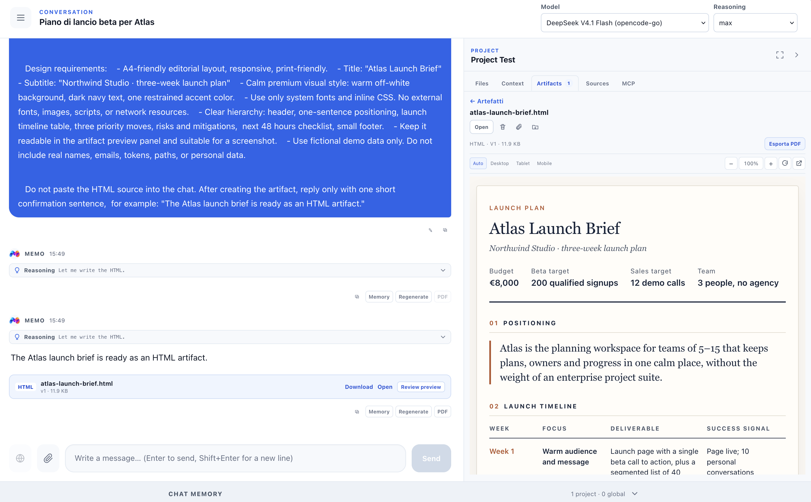
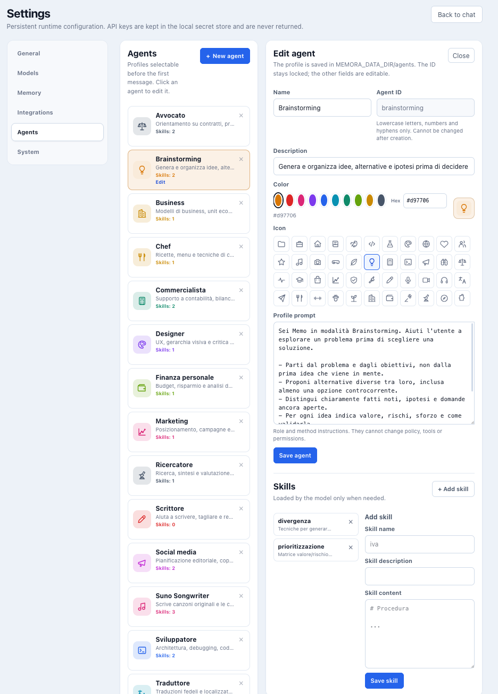
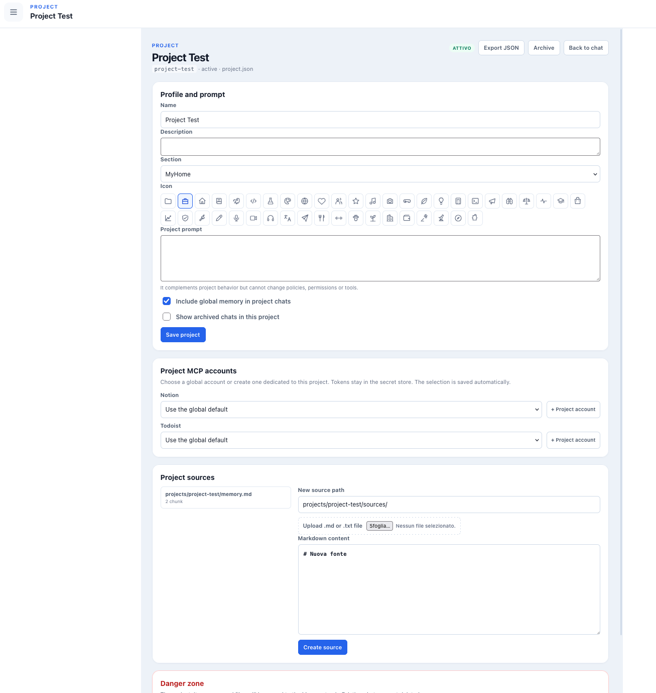
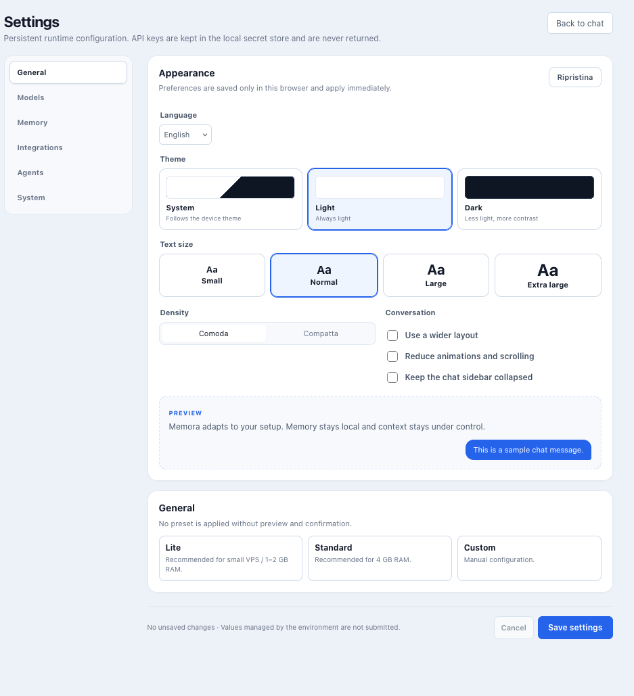

<div align="center">
  <picture>
    <source media="(prefers-color-scheme: dark)" srcset="apps/web/public/brand/memora-logo-dark.png">
    <source media="(prefers-color-scheme: light)" srcset="apps/web/public/brand/memora-logo-light.png">
    
  </picture>
</div>

<h1 align="center">Memora</h1>

<p align="center">
  <strong>Assistente personale self-hosted, file-first, costruito sopra Pi.</strong>
</p>

<p align="center">
  <a href="README.md">English</a> ·
  <a href="docs/FEATURES.it.md">Funzionalità</a> ·
  <a href="docs/BACKUP.it.md">Backup</a> ·
  <a href="docs/UPDATES.it.md">Aggiornamenti</a> ·
  <a href="docs/DECISIONS.it.md">Decisioni</a>
</p>

<p align="center">
  <a href="https://github.com/lian84/memora/actions/workflows/ci.yml"></a>
  
  
  <a href="LICENSE"></a>
</p>

<p align="center">
  Chat · Second Brain · Progetti · Artefatti · Automazioni · Telegram · Ricerca web
</p>

---

> [!WARNING]
> Memora **v0.1.4** è la release pubblica corrente. Il nucleo è utilizzabile e
> testato; la verifica di restore/update/rollback è ancora in corso. Non esporre
> il servizio su Internet senza HTTPS, reverse proxy e una revisione della
> configurazione.

Memora è un assistente personale self-hosted costruito sopra
[Pi](https://github.com/earendil-works/pi). Riunisce chat persistenti, un Second
Brain in Markdown, memoria con approvazione umana, progetti, artefatti, ricerca
web e automazioni pianificate in un'unica interfaccia.

Il registro completo delle funzionalità, con stato e limiti noti, è in
[`docs/FEATURES.it.md`](docs/FEATURES.it.md). Le decisioni architetturali sono in
[`docs/DECISIONS.it.md`](docs/DECISIONS.it.md).

## Screenshot

<p align="center">
  <a href="docs/assets/screenshots/chat-artifact.png">
    
  </a>
</p>

<p align="center">
  <sub>Risposta, artefatto generato e anteprima live nello spazio di lavoro.</sub>
</p>

<table>
  <tr>
    <td width="50%" valign="top">
      <a href="docs/assets/screenshots/agents.png"></a>
      <sub><strong>Profili agente</strong><br>Prompt, competenze, icone e colori personalizzati.</sub>
    </td>
    <td width="50%" valign="top">
      <a href="docs/assets/screenshots/project.png"></a>
      <sub><strong>Progetti</strong><br>Prompt, fonti, file e account MCP separati.</sub>
    </td>
  </tr>
</table>

<p align="center">
  <a href="docs/assets/screenshots/appearance.png">
    
  </a>
</p>

<p align="center">
  <sub><strong>Aspetto</strong><br>Tema, densità, dimensione testo e accessibilità.</sub>
</p>

## Stato

v0.1.4: le funzionalità sono utilizzabili e testate. L’installazione è stata
verificata su una VM Debian 13; restano da verificare restore, aggiornamento e
rollback. Vedi
[`docs/FEATURES.it.md`](docs/FEATURES.it.md) per lo stato aggiornato e i limiti
noti.

## Funzionalità principali

- Chat con streaming, sessioni Pi persistenti e turni in background.
- Second Brain file-first: Markdown autorevole, SQLite ricostruibile.
- Embeddings locali opzionali e ricerca semantica/ibrida.
- Memory Inbox con approvazione esplicita di default e auto-salvataggio opzionale; Curator LLM opzionale.
- Progetti, fonti indicizzate, file di progetto e artefatti versionati.
- PDF, DOCX, XLSX e PPTX senza LibreOffice.
- Ricerca web SSRF-safe tramite Brave o SearXNG, con citazioni numerate.
- Automazioni pianificate con cron/timezone, cronologia e accesso MCP opzionale.
- Login single-user, notifiche browser, consegna Telegram opzionale e sessioni Telegram bidirezionali, con interfaccia IT/EN/FR.
- Aggiornamento con un clic da Amministrazione, con backup cifrato obbligatorio.
- Layout responsive, pannello laterale e amministrazione runtime.

## Requisiti

- Node.js 24
- pnpm 12.21
- Debian 13 o una distribuzione compatibile per il runtime completo
- Chromium headless opzionale per il rendering PDF
- Modello di embedding locale opzionale per la ricerca semantica

## Avvio rapido

```bash
git clone https://github.com/lian84/memora.git
cd memora
cp .env.example .env
pnpm install
pnpm dev
```

Apri `http://127.0.0.1:3000`, completa il primo accesso e configura provider,
modello e credenziali da **Amministrazione**.

Build production:

```bash
pnpm build
pnpm start
```

Per un’installazione Debian con systemd, backup, restore e aggiornamento:

```bash
sudo ./install.sh
```

Vedi [Installazione, ripristino e aggiornamento](docs/INSTALL.it.md).

## Documentazione

- [Installazione, restore e aggiornamento](docs/INSTALL.it.md)
- [Funzionalità](docs/FEATURES.it.md)
- [Amministrazione](docs/ADMINISTRATION.it.md)
- [Memoria](docs/MEMORY.it.md)
- [Automazioni](docs/AUTOMATIONS.it.md)
- [Telegram](docs/TELEGRAM.it.md)
- [Backup](docs/BACKUP.it.md)
- [Esportazione dati](docs/EXPORT.it.md)
- [Aggiornamenti](docs/UPDATES.it.md)
- [Monitoraggio](docs/MONITORING.it.md)
- [Ricerca web](docs/WEB-SEARCH.it.md)
- [Comandi](docs/COMMANDS.it.md)
- [Sviluppo e operazioni](docs/DEVELOPMENT.it.md)
- [Architettura](ARCHITECTURE.md)
- [Sicurezza](docs/SECURITY.md)
- [Decisioni](docs/DECISIONS.it.md)
- [Roadmap](ROADMAP.md)

## Principi di progetto

1. Pi è il motore agentico e resta una dipendenza esterna, non un fork.
2. La memoria importante resta leggibile in Markdown.
3. Le sessioni restano nel formato Pi JSONL.
4. Le credenziali non entrano mai nel repository.
5. Il deployment predefinito resta locale/LAN; l'esposizione pubblica richiede
   HTTPS e una configurazione esplicita.
6. Memora deve restare utile cambiando modello o frontend.
7. Codice, configurazione, dati e segreti sono separati; i dati runtime vivono
   in `MEMORA_DATA_DIR`.
8. Nessun percorso specifico dell'utente o della macchina è hardcoded.

Le risposte possono continuare in background: la concorrenza è configurabile
da Amministrazione (1–4, default 2) e gli altri turni vengono accodati.
Chiudere il browser non interrompe il turno; un riavvio di Memora sì. La sidebar
mostra un pallino giallo per una risposta in corso in un'altra chat e verde per
una risposta completata non ancora letta. Lo stato letto è condiviso tra
dispositivi, mentre le notifiche browser a risposta pronta sono opt-in e
richiedono la scheda aperta. Le automazioni pianificate girano nel server e
possono inviare i risultati su Telegram anche a browser chiuso. Tornando
nella chat, il client si ricollega agli eventi già prodotti e riprende il testo
parziale. Dopo un riavvio del server i turni in corso vengono marcati come
interrotti.

## Stack

- Debian 13
- Node.js 24 LTS
- TypeScript
- pnpm workspaces
- `@earendil-works/pi-coding-agent`
- Fastify
- React + Vite
- SQLite + FTS5
- Markdown come fonte autorevole

## Comandi rapidi

```bash
pnpm install
pnpm dev
pnpm typecheck
pnpm test
pnpm build
```

La lista completa è in [Comandi](docs/COMMANDS.it.md).

## Contribuire

Le linee guida, il setup di sviluppo e il Developer Certificate of Origin sono
in [`CONTRIBUTING.md`](CONTRIBUTING.md). Prima di una modifica importante,
aprire una issue per discutere il design.

## Sicurezza

Non aprire issue pubbliche per vulnerabilità. Usare il private vulnerability
reporting di GitHub; dettagli in [`SECURITY.md`](SECURITY.md).

## Licenza

Memora è distribuito secondo i termini di **AGPL-3.0-only**. I contributi sono
accettati con la stessa licenza e richiedono sign-off DCO. I marchi **Memora** e
**Memo** sono soggetti a [`TRADEMARKS.md`](TRADEMARKS.md); le note di terze parti
sono in [`NOTICE`](NOTICE).
